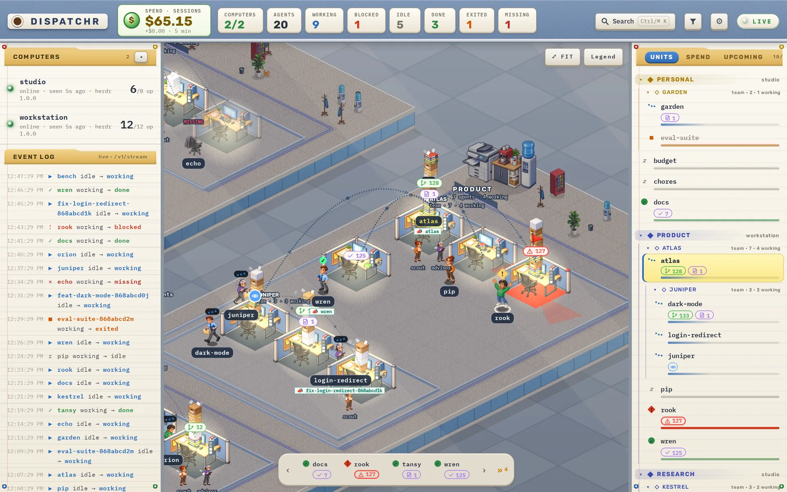
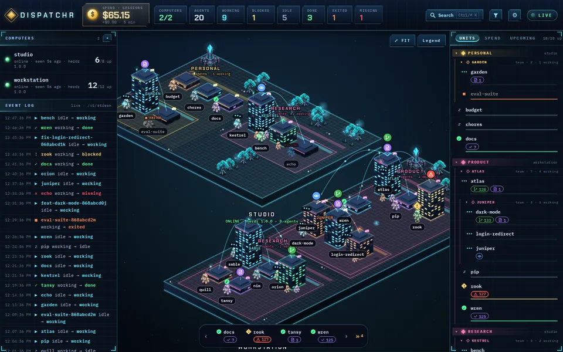
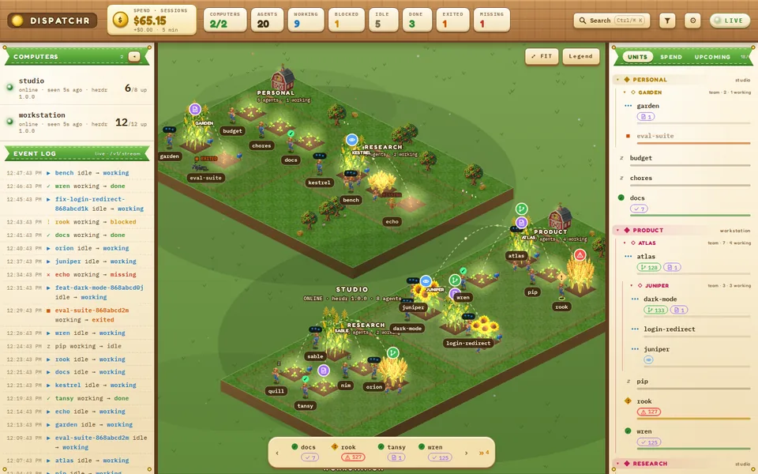
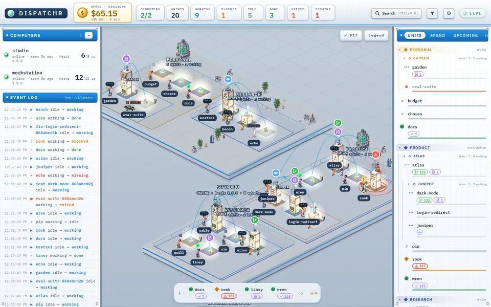

# dispatchr

A game-like place to watch your coding agents work. Each computer is an island, each agent a
building with its character out front, and what they are doing right now is something you can see:
who is working and for how long, who is blocked and waiting on you, who just finished.



*A made-up org: two computers, three spaces, teams with their leads. The Cubicles theme; Neon city,
Farm and Lab show the same agents another way.*

| Neon city | Farm | Lab |
|---|---|---|
|  |  |  |

dispatchr is a client of [rostr](https://github.com/frankjoshua/rostr), a registry for long-running
coding agents (Claude Code, Codex, Pi, omp) that live in [herdr](https://github.com/herdrdev/herdr)
terminal panes on one or more computers. rostr knows which agents exist, where, and what each is
doing; dispatchr reads all of it through rostr's REST API and event stream and draws it. It never
talks to herdr or the agents itself.

Status: v0, observe only. Nothing in it can change anything: it only sends `GET`.

## Run it

You need Node 22 (22.12 or newer), 24, or 26+ and a rostr server to watch, with at least one computer
enrolled and agents on it.

```bash
npm ci
cp .env.example .env      # how to reach rostr: VITE_ROSTR_URL, or ROSTR_URL + ROSTR_TOKEN
npm run dev               # http://localhost:5180
```

Two ways to reach rostr, never both:

- **Direct, as yourself** (`VITE_ROSTR_URL` = rostr's tailnet address, where `tailscale serve` names
  every visitor): the browser calls rostr there and each person sees what their own grants allow; the
  settings menu (⚙) says who rostr takes you for. No token anywhere, and the dev server proxies nothing.
  rostr must list dispatchr's origins (each address it is opened at, e.g. `http://localhost:5180`) in
  its `ROSTR_CORS_ORIGINS`.
- **Through a token** (`ROSTR_URL` + `ROSTR_TOKEN`, a viewer token is enough): the dev server proxies
  `GET /v1/*` to rostr and adds `Authorization: Bearer $ROSTR_TOKEN` there, so the token never reaches
  the browser and no CORS is needed; other methods get 404. Everyone using dispatchr then sees what the
  token sees. `/v1/stream` to an `https` rostr goes over HTTP/2 (see [API-GAPS.md](API-GAPS.md) §4).

To try it without a real fleet, start the throwaway server from rostr's test harness (in a rostr
checkout: `test/harness/run --shell`, then `setup; herdr_start`) and point a dev server at it:
`ROSTR_URL=http://127.0.0.1:8791 ROSTR_TOKEN=<harness owner token> npx vite --port 5181`.

To open it from other devices on a tailnet, put the dev server behind `tailscale serve`
(`tailscale serve --bg --https=<port> http://127.0.0.1:5180`), add the machine's tailnet name to
`DISPATCHR_ALLOWED_HOSTS` in `.env` (Vite refuses Host names it does not know), and, in the direct
mode, that `https://` origin to rostr's `ROSTR_CORS_ORIGINS`.

`npm run check` type-checks; `npm test` runs the game rules' unit tests without needing a server or
`.env`; `npm run build` writes a static `dist/` with no token in it.

## Serve it

`deploy/` builds the site into a small nginx container (`deploy/docker-compose.yml`, on
`127.0.0.1:${DISPATCHR_PORT:-8790}`). The site holds no token: the browser reaches rostr itself. The
container sends a Content-Security-Policy that lets the page talk only to itself and to the rostr
address it was built with.

- **Its own tailnet name** (`https://dispatchr.<tailnet>.ts.net/`): add `deploy/tailscale.yml`, a
  Tailscale container that joins the tailnet as its own device and serves the site, with no Tailscale
  needed on the host: `docker compose -f deploy/docker-compose.yml -f deploy/tailscale.yml up -d --build`.
  Approve the device once at the login URL in `docker logs dispatchr-tailscale` within 15 minutes (or
  set `TS_AUTHKEY`); the login is kept and reused on restarts.
  Build with `VITE_ROSTR_URL` set to rostr's tailnet address, and add
  `https://dispatchr.<tailnet>.ts.net` to rostr's `ROSTR_CORS_ORIGINS`.
- **A path beside rostr** (no second device): build with `DISPATCHR_BASE=/map/` and add the path on
  rostr's host, `tailscale serve --bg --set-path /map http://127.0.0.1:8790`. Same origin as rostr, so
  no CORS origin is needed.

Either way every viewer is who Tailscale says they are and sees only their own grants.

## What you see

[docs/guide.md](docs/guide.md) describes every part in full; [GLOSSARY.md](GLOSSARY.md) names them.
In short:

- **The map.** Computers are islands, spaces are districts, teams are fenced blocks around their
  lead, and each agent is a place (a tower, a crop plot, an instrument column, a cubicle) with its
  character. A working agent's place grows the longer its current run goes on and its character
  carries work to the computer's base; a blocked one waves at you; an idle or finished one that has
  been quiet for an hour goes home; a missing one leaves a ghost. Recently active agents are bright,
  the rest dim, and agents quiet for a week are packed away.
- **Live.** Every rostr event plays on the map as it happens (launches beam in, status changes ring,
  spend flies into the roof as embers, coins, drops or banknotes) and lands in the event log.
- **Badges.** Plugins on your computers report tokens for an agent (a merge request's state, a
  task's title); you decide in ⚙ → Badges… which become badges over its place, with what icon, colour
  and urgency. Artifacts an agent published and schedules that target it show as counts you can open.
- **Selecting and opening.** Tap an agent anywhere (map, units list, search, event log) to select it
  everywhere at once; double-tap, or pick it in search, to open its web terminal in a tab that is
  reused rather than piling up. **Show info** in its menu opens the unit card: who it reports to,
  its folder, session, model and effort, channels, spend and recent events.
- **The working loop.** A bar along the bottom lists the agents that need you (done, blocked or
  carrying an alarm badge), or all of them; step round it and fast-forward to the next one waiting.
- **Panels.** Computers and the event log on the left; the units list, Spend and Upcoming (rostr's
  schedule inventory) on the right; tabs on a phone.
- **Themes.** Neon city, Farm, Lab and Cubicles: the same data, drawn by a different painter.
- **Model characters.** Fable has a burgundy-and-gold character, distinct from Sol, in every theme.
  In ⚙ → Model characters…, assign any of the five graphics to model names or wildcard patterns,
  with picture previews. Cubicles also shows effort through the character's posture and desk block.
- **Yours.** The theme, what is dimmed, packed away or hidden, a space and tag filter, badge rules and
  model-character assignments are your settings, kept in your browser.

### Keys

| Key | Does |
|---|---|
| `/`, `Ctrl+K`, `⌘K` | Search agents; Enter opens the highlighted agent's web terminal |
| `.` `,` | Next and previous agent in the working loop |
| `>` | Fast forward to the next agent that needs attention |
| `F` | Fit the map to the agents |
| `I` | Show or hide the selected agent's unit card |
| `[` `]` | Fold the left and right panels |
| `Esc` | Close what is open; with nothing open, clear the selection |

## Layout

Data → game rules → engine → presentation and panels. Rules never draw; the engine never fetches.

- **Data:** `src/api.ts` (GET calls, SSE over fetch) · `src/store.ts` (snapshot, event log, live
  stream) · `src/usage.ts` (current-session spend, live deltas) · `src/schedule-store.ts` and
  `src/schedule-types.ts` (schedule inventory) · `src/types.ts`, `src/data.ts` (API shapes and guards) ·
  `src/settings.ts`, `src/character-settings.ts`, `src/filter.ts`, `src/loop-state.ts` (what the viewer chose, per browser).
- **Game rules** (pure, unit-tested): `src/presence.ts` and `src/recency.ts` (packing, sleep, light,
  ordering) · `src/runs.ts` and `src/stack.ts` (a run's working time and the height it gives) ·
  `src/teams.ts` (team nesting) · `src/badges.ts` (badge rules) · `src/attention.ts` and `src/loop.ts`
  (who needs you, and stepping round the loop) · `src/nameplate.ts` (short names) · `src/search.ts` ·
  `src/inference.ts` (model cast and effort tier) · `src/artifacts.ts` · `src/schedule-rules.ts`
  (evidence-aware timing) · `src/presence-state.ts` (applies the rules to the stores for the map and
  panels).
- **Engine:** `src/map.ts` (canvas renderer, camera, input, event effects) · `src/world.ts` (where
  islands, districts and places go) · `src/effects.ts` (bounded effect queues) · `src/framing.ts`
  (Fit's camera) · `src/shapes.ts` (what each place covers, so taps land on what is drawn) ·
  `src/sprites.ts` (loading and drawing the art in `public/art/`).
- **Presentation:** `src/theme.ts` (themes and palettes) · `src/painters.ts` (what a painted theme
  draws) · `src/farm.ts`, `src/lab.ts`, `src/cubicles.ts` (the painted themes; the neon city is drawn
  in `map.ts`) · `src/icons.ts` (badge icons) · `src/format.ts` (colours by meaning, event wording).
- **Panels:** `src/ui.ts` (top bar, lists, unit menu and card) · `src/loop-bar.ts` · `src/spend.ts` ·
  `src/schedule-panel.ts` (Upcoming) · `src/artifact-panel.ts` · `src/badge-editor.ts` ·
  `src/legend.ts` · `src/model-character-editor.ts` · `src/tabs.ts` (shared and own tabs for links).
- `src/main.ts` plugs the HTTP adapter into everything that reads through it; `vite.config.ts` is
  the dev proxy; `deploy/` the container.

## Contract with rostr

- API: rostr's `openapi.yaml` (also served by every rostr server at `GET /openapi.yaml`). dispatchr
  uses only `GET /v1/me`, `/v1/nodes`, `/v1/agents`, `/v1/spaces`, `/v1/agents/{ref}/contact`, `/v1/events`,
  `/v1/usage`, `/v1/schedules` and `/v1/stream` (log events and `usage` frames). What it needs and the
  API lacks is in [API-GAPS.md](API-GAPS.md).
- Auth: the viewer's own Tailscale identity at rostr's tailnet address (direct mode), or a bearer
  token the dev server adds (proxy mode). `GET /v1/me` says which.

## Contributing

[CONTRIBUTING.md](CONTRIBUTING.md) has the rules the code is built by; report security problems as
[SECURITY.md](SECURITY.md) says.

## Licence

[MIT](LICENSE). The sprites and textures in `public/art/` were generated for dispatchr with an image
model ([public/art/README.md](public/art/README.md) says how) and come under the same licence. The
fonts are under the SIL Open Font License: Rubik in `public/fonts/` with its notice, the others from
the `@fontsource` packages.
